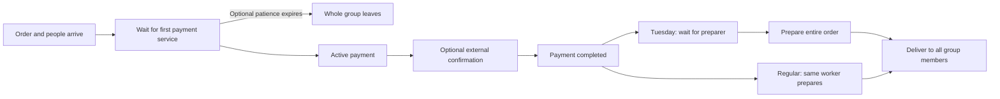

## Context

See [shared baseline](../../README.md) and this change's proposal/spec. This design was written before implementation and now describes the implemented spec01 contracts; downstream changes reference them. The five public test boundaries are already approved. The user adopted the [selective TDD policy](../../README.md#selective-tdd-policy) on 2026-10-22.

## Goals / Non-Goals

**Goals:** correct resource ownership, one workload per order, individual identities, reproducible virtual-time history and independently solved acceptance cases.

**Non-Goals:** stochastic generation, statistical aggregation, source import, HTTP, visuals, actual calibration and product-level preparation.

## Decisions

### Public deterministic interface and tooling

Use `simulate(config: EngineConfig, demand: list[OrderInput], initial_state: list[InitialOrder]) -> SimulationTrace`. Domain types live in the Python package and are independent of FastAPI. Use validated typed models that can serialize to JSON; no second set of conflicting HTTP domain definitions. Raise `InputValidationError` with a list of `{path, code, message}` before scheduling. Do not expose private SimPy events as public contracts.

Bootstrap Python 3.13 with `uv`, pytest, Ruff and mypy; add the engine's SimPy/typed-model dependencies and a lockfile. Confirm the runner works with a temporary smoke check. Apply focused RED/GREEN cycles to uncovered critical engine rules and bug regressions; existing covered behavior and cohesive integration can be verified per block. Preserve the 37 baseline tests and honest test chronology. Do not generate the frontend in this change.

### Inputs and units

| Type | Required meaning |
| --- | --- |
| `EngineConfig` | `contract_version=1`, `mode` (`tuesday` or `regular`), `opening_time` (`HH:MM:SS`, default `15:00:00`), `horizon_s` (default 23400), active pool capacities |
| Tuesday capacities | `cashiers=1`, `preparers=4`; no integrated workers |
| Regular capacities | `integrated_workers=1`; no separate cashier/preparer pools |
| `OrderInput` | `order_id`, nonempty unique `person_ids`, `arrival_s`, `payment_active_s`, `transfer_wait_s`, `preparation_s`, optional `patience_s` (`null` means disabled) |
| `InitialOrder` | Order identity/person links, optional known `arrival_s <= 0`, explicit `stage`, `queue_rank` if queued, worker if reserved, remaining current-stage seconds and durations of future stages |

Ordinary demand arrival offsets are finite and nonnegative; inputs at or beyond H are valid scheduled demand but not admitted. Initial orders use their separate initialization list and never generate a second arrival. IDs are unique across both lists. Capacities in active pools are integers >= 1; reject incompatible nonzero inactive pools. All durations are finite and >= 0, including zero-duration stages; H is positive and finite. No implicit defaults for per-order required durations.

Initial stages: `waiting_payment`, `payment_active`, `payment_pending`, `waiting_preparation`, `preparing`. `waiting_preparation` is Tuesday-only. `payment_pending` needs a reserved worker in regular mode and no worker in Tuesday mode. Current active stages require `remaining_s`; pending payment requires remaining confirmation plus future preparation duration. Initial queued payment orders have optional remaining patience rather than reconstructing their original deadline. Initial queued orders precede new t=0 arrivals using explicit `queue_rank`. Reject duplicate ranks within a queue, unknown workers, overcapacity and contradictory stage assignments. Unknown past stage timestamps remain null; metrics later report their availability rather than inventing history.

### Resource state machine

The Tuesday cashier is released between P and E. The regular worker stays reserved through P/E/I/F but is active only in P and I. No second cashier verification stage is modeled. Worker identities are stable pool-prefixed IDs sorted numerically. Resource capacity, assignments and active status must share one authoritative registry; do not double-reserve capacity through separate person processes.

Use coordinated SimPy processes and stable FIFO dispatch. Queue items are orders. Person state transitions are projections of the order's shared transitions, not independent payment/preparation processes. At a timestamp, process stage completions/releases and confirmations, arrivals, eligible dispatch, then patience expiry for orders still waiting. Drain any resulting zero-time transitions before advancing. This gives service priority at a deadline and deterministic stable ties without reading or monkey-patching SimPy's private queue. An order that already started payment is immune to patience even while externally pending.

### Trace contract version 1

`SimulationTrace` contains configuration, declared resource identities, initialized/new entity registries, `events`, `window_end_s`, `drain_end_s` and final order/person/worker states. It has no runtime wall-clock timestamps in its deterministic payload.

Each event has `seq` (monotone integer starting at 0), `time_s`, `type`, `order_id` (nullable for window events), `person_ids`, `worker_id` (nullable), and `data` for the defined event details. Types are `order_initialized`, `order_arrived`, `payment_started`, `payment_active_ended`, `payment_completed`, `preparation_started`, `order_delivered`, `order_abandoned`, `admissions_closed`, `run_finished`. Initialization data includes initial stage, queue rank and resource reservation/active state. Start/end events carry the stage and resulting worker reservation/active state so consumers need no internals. `order_delivered` releases the preparer/integrated worker and completes every linked person; `payment_active_ended` releases only a Tuesday cashier. A `payment_completed` event always follows active-end, even for zero confirmation time. `run_finished` occurs at `max(H, final admitted/initial completion)` so an empty run still declares its full window.

Tuesday paid queue membership starts at `payment_completed` and ends at `preparation_started`. Active payment and pending transfers are not queued payment orders. Initialization and arrival put entities into the correct pre-dispatch state. Same-time effects are ordered by `seq`. No physical exit or consumption period is added after receiving the order.

### Acceptance oracles

For two one-person orders at 0 and 1 with payment 2, preparation 3 and no external wait, Tuesday 1+4 completes at 5 and 7; regular 1 completes at 5 and 10. These are manual expected timelines, not executed tests. Include queue-capacity and stable tie fixtures as well as group duplication, transfer, patience, initialization and closing fixtures. Test the public trace and end states, not internal resource method calls.

## Risks / Trade-offs

- Ambiguous measurements -> engine consumes explicit hypothetical inputs; import never silently supplies them.
- Same-time races -> public trace acceptance cases cover zero durations, capacity releases and patience ties.
- Missing historical initial timestamps -> preserve nulls and distinguish residual occupancy from unavailable full durations.
- Aggregate order preparation ignores menu/group effects -> expose the per-order assumption in run metadata.

## Migration Plan

New local modules only; no migrations or remote deployment. Revert only implementation changes introduced by this change if later authorized rollback is needed; never alter source observations. Gate acceptance on the approved engine scenarios and actual Python checks.

## Open Questions

No implementation-blocking decisions remain. Historical source links, active cashier work measurements and representative other-day data remain field-research gaps; they do not block explicit synthetic inputs.
